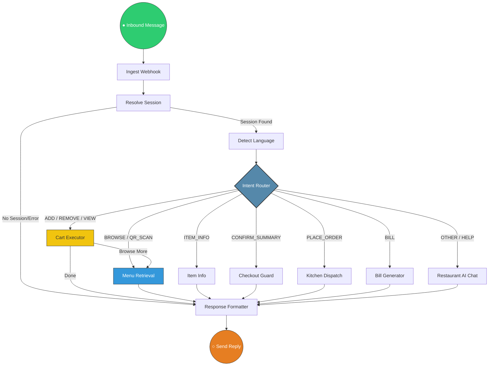

# Hello Dine: LangGraph Logic Flow (Node-Edge Diagram)

This document visualizes the "Brain" of the WhatsApp bot. It follows a state-machine architecture where each **Node** (box) is a processing step and each **Edge** (arrow) is a logical transition.

## 1. Visual Flow (Mermaid)

The diagram below shows the 1:1 mapping of the processing nodes defined in `backend/app/bot/graph.py`.

## 2. Full Architecture Visualization

## 3. Node & Edge Definitions

| Node Name | Category | Purpose |
| :--- | :--- | :--- |
| **Ingest Webhook** | Entry | Parses the raw JSON from Meta/WhatsApp API. |
| **Resolve Session** | Security | Pairs the phone number to a specific Table/Branch. |
| **Intent Router** | Brain | **Powered by Gemini AI**: Decides exactly what the user wants. |
| **Cart Executor** | Action | Logic for `Add to Cart`, `Remove`, or `Update Quantity`. |
| **Checkout Guard** | Safety | Validates item availability and total amounts before ordering. |
| **Kitchen Dispatch** | Integration | Sends the order to the **Chef's Kitchen Board** via WebSockets. |
| **Response Formatter** | Output | Converts data into high-end WhatsApp Lists or Buttons. |

## 4. Logical Edges (Transitions)
- **Conditional Edge**: The `Intent Router` acts as a traffic controller. If the AI detects "I'm hungry", it points the edge towards `Menu Retrieval`.
- **Loop Edge**: After adding an item to the `Cart`, the edge can point back to `Menu Retrieval` to encourage the user to order more.
- **Terminal Edge**: Every flow eventually converges at `Response Formatter` to ensure the customer always gets a reply.

---
*Technical System Diagram - Hello Dine v2.0*
