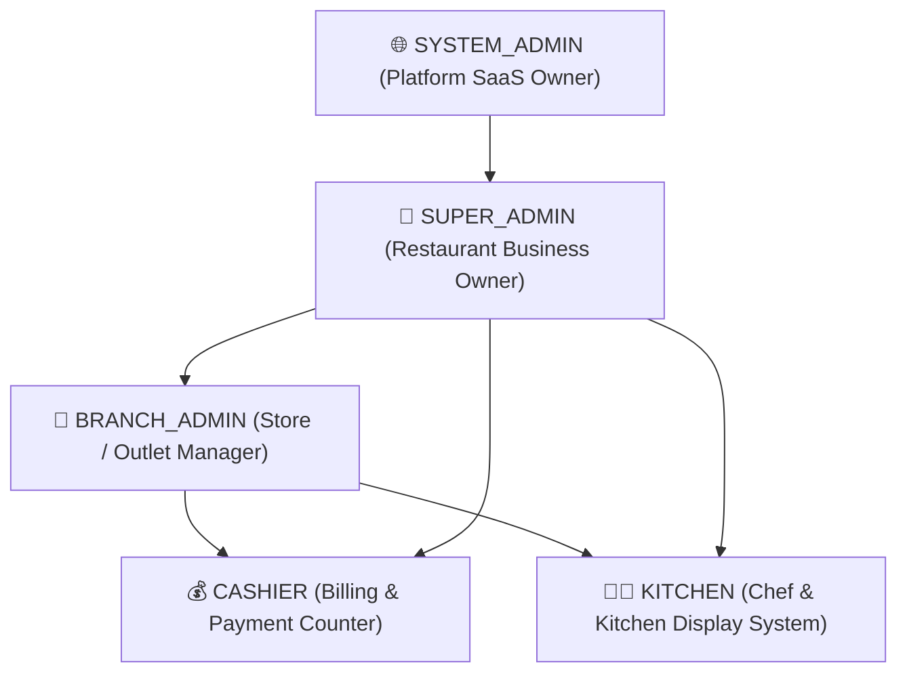

# HelloDine 🍽️
> **Next-Generation AI Restaurant Operating System**: Tablet & Mobile Kiosk, WhatsApp Ordering, Voice AI Waiter, Live Kitchen Display (KDS), Cashier Billing & GST Invoicing.

---

## 🌟 Overview

**HelloDine** is a comprehensive, production-grade restaurant automation SaaS engineered for modern hospitality. It transforms dining through dual-channel customer ordering (Interactive Tablet/Mobile Web Kiosk + Conversational WhatsApp Bot), real-time kitchen orchestration, and instant cashier billing.

### Key Highlights
- **🤖 Dual-Channel Customer Ordering**:
  - **Table Kiosk UI (`/table/:token` & `/kiosk`)**: Rich touch ordering, multi-dish selection, spice & modifier customization, voice input, AI assistant conversation, and interactive birthday celebrations.
  - **WhatsApp Cloud API Bot**: Fully conversational ordering and inquiry powered by LangGraph & Google Gemini 2.5 Flash.
- **⚡ Voice AI Waiter**:
  - Browser Speech Recognition + Web Speech Synthesis with human prosody.
  - Instant zero-token intent matching (<1ms) for common tasks (Cart, Best Dishes, Order Status, Bill Check, Jokes, Cartoons).
  - Dynamic Gemini LLM fallback for free-form customer inquiries, dietary preferences, and flavor descriptions.
- **👨‍🍳 Real-time Kitchen Display System (KDS / `/orders`)**:
  - Live Kanban board (`New` $\to$ `Accepted` $\to$ `Preparing` $\to$ `Ready` $\to$ `Served`).
  - Sub-millisecond WebSocket updates across kitchen screens and table tablets with status regression guards and announcement deduplication.
- **💰 Cashier Billing & GST Invoicing (`/billing`)**:
  - Real-time session billing, item breakdown, automatic CGST & SGST calculation (compliant with Indian tax standards), dynamic table-level UPI QR codes, and instant table turnover.
- **🏢 Multi-Tenant SaaS Hierarchy**:
  - Multi-tenant architecture (`Restaurant` $\to$ `Branch` $\to$ `Tables` $\to$ `Staff`).
  - Role-Based Access Control (`SYSTEM_ADMIN`, `SUPER_ADMIN`, `BRANCH_ADMIN`, `CASHIER`, `CHEF`).

---

## 🏗️ Architecture & Tech Stack

```
HelloDine/
├── backend/                  # FastAPI REST & WebSocket Backend
│   ├── app/
│   │   ├── bot/              # LangGraph Conversational AI State Graph
│   │   │   ├── nodes/        # Intent router, cart/order, billing, entertainment, chat
│   │   │   └── wa_sender.py  # WhatsApp Cloud API integration
│   │   ├── models/           # SQLAlchemy Async PostgreSQL ORM Models
│   │   ├── routers/          # API Routers (kiosk, orders, billing, menu, auth, admin)
│   │   └── services/         # Order, billing, cache, and WebSocket connection manager
│   ├── requirements.txt
│   └── seed.py               # Database seeder
└── frontend/                 # React 18 + Vite + TypeScript PWA
    ├── src/
    │   ├── pages/
    │   │   ├── kiosk/        # Customer Table Kiosk & Voice AI Waiter
    │   │   ├── OrdersBoard/  # Live Kitchen Kanban Board (KDS)
    │   │   ├── Billing/      # Cashier Invoicing & Payments
    │   │   └── admin/        # Menu, Branch, Staff, Table Management
    │   └── api/              # Axios & WebSocket client
    └── package.json
```

### Core Technologies
- **Backend**: FastAPI (Python 3.12+), SQLAlchemy 2.0 (Async), PostgreSQL (Supabase / local asyncpg), Redis / In-Memory Ultra-Fast Cache, WebSockets.
- **AI & NLP**: LangGraph, Google Gemini 2.5 Flash (`langchain-google-genai`), Zero-Token NLU Router.
- **Frontend**: React 18, Vite, TypeScript, Lucide Icons, Canvas Confetti, Web Speech API.
- **Integrations**: Meta WhatsApp Cloud API, Indian UPI Payment QR Specifications, Indian GST Compliance.

---

## 🚀 Getting Started Locally

### Prerequisites
- Python 3.11+ or 3.12+
- Node.js 18+ and npm
- PostgreSQL database (or Supabase project)

---

### 1. Backend Setup

```bash
cd backend

# Create and activate virtual environment
python -m venv venv
# On Windows:
venv\Scripts\activate
# On Linux/macOS:
source venv/bin/activate

# Install dependencies
pip install -r requirements.txt

# Configure environment variables
cp ../.env.example .env
```

#### Required Environment Variables (`.env`):
```ini
DATABASE_URL=postgresql+asyncpg://<user>:<password>@<host>:<port>/<dbname>
SECRET_KEY=your_secure_jwt_secret
GEMINI_API_KEY=your_gemini_api_key

# Optional for WhatsApp Cloud API
WA_PHONE_NUMBER_ID=your_meta_phone_id
WA_ACCESS_TOKEN=your_meta_system_user_token
WA_WEBHOOK_VERIFY_TOKEN=hellodine
```

#### Seed Initial Data & Start Server:
```bash
# Seed initial demo restaurant, tables, categories, menu items, and admin accounts
python seed.py

# Start backend server
uvicorn app.main:app --reload --host 0.0.0.0 --port 8000
```
Backend API will be live at `http://localhost:8000` (Swagger docs: `http://localhost:8000/docs`).

---

### 2. Frontend Setup

```bash
cd frontend

# Install packages
npm install

# Build & run development server
npm run dev
```
Frontend application will be accessible at `http://localhost:5173`.

---

---

## 👥 Role-Based Access Control & User Hierarchy

HelloDine implements a strict multi-tenant role hierarchy designed for single-restaurant setups or multi-outlet restaurant chains:



### Role Breakdown & Capabilities

#### 1. 🌐 SYSTEM_ADMIN (Platform SaaS Owner)
* **Who it is:** The application owner / platform administrator hosting the HelloDine SaaS.
* **Scope & Responsibilities:**
  * Global platform-level control across all restaurant tenants.
  * Onboards and activates new restaurants.
  * Resets Super Admin passwords if an owner gets locked out.
  * Can view and bind kiosk tables across any restaurant in the system.
  * Accesses the dedicated System Dashboard at `/system`.

#### 2. 👑 SUPER_ADMIN (Restaurant Owner / General Manager)
* **Who it is:** The business owner of an individual restaurant (e.g. *Spice Garden*).
* **Scope & Responsibilities:**
  * Owns the entire restaurant brand and all its branches.
  * Creates, edits, and manages **multiple branches** (e.g., Campus Branch, Downtown Branch).
  * Manages **restaurant-wide menu categories, dishes, prices, and bestsellers**.
  * Creates and manages **all staff roles** (Branch Admins, Cashiers, Chefs).
  * Views **consolidated multi-branch sales and GST reports**.
  * Configures **merchant UPI ID and tax settings**.

#### 3. 🏢 BRANCH_ADMIN (Branch / Outlet Manager)
* **Who it is:** The manager assigned to one specific physical location/outlet.
* **Scope & Responsibilities:**
  * **Strictly isolated to their assigned branch:** Cannot access or modify other branches of the restaurant.
  * Manages **Tables** for their branch (add tables, edit table numbers, generate QR codes, launch tablet kiosks).
  * Manages **Staff for their branch only** (adds Cashiers, Waiters, and Kitchen Chefs).
  * Oversees **live orders, kitchen workflow, and daily operational reports** for their outlet.
  * *Constraint:* Cannot create other Branch Admins or Super Admins, and cannot delete branches.

#### 4. 💰 CASHIER (Billing & Checkout Staff)
* **Who it is:** The cashier or captain managing table turnover and customer payments.
* **Scope & Responsibilities:**
  * Real-time billing dashboard (`/billing`).
  * Generates GST invoices (CGST + SGST) and presents UPI QR codes for payment.
  * Approves UPI payments, closes table sessions, and frees tables for incoming guests.

#### 5. 👨‍🍳 KITCHEN (Chef & Kitchen Display Team)
* **Who it is:** Chefs and kitchen supervisors in the food preparation area.
* **Scope & Responsibilities:**
  * Live Kitchen Display Kanban Board (`/orders`).
  * Real-time acoustic chimes for new incoming orders from Table Kiosks.
  * Progresses order tickets through `Accepted` $\to$ `Preparing` $\to$ `Ready` $\to$ `Served`.

---

## 🔑 Default Credentials (Seeded)

When running `python seed.py`, the following demo accounts are seeded into the database:

| Role | Username / Mobile | Password / PIN | Access Scope & Purpose |
| :--- | :--- | :--- | :--- |
| **🌐 System Admin** | `+91 9000000000` | `sysadmin123` | Platform-wide SaaS Dashboard (`/system`) |
| **👑 Super Admin** | `+91 9000000001` | `admin123` | Restaurant Owner (Full Restaurant & Multi-Branch Access) |
| **🏢 Branch Admin** | *Created by Super Admin via Staff Admin* | *Set by Super Admin* | Assigned Single Branch Manager (`/admin/tables`, `/admin/staff`) |
| **💰 Cashier** | `+91 9000000003` | `cashier123` | Cashier Billing & Payments (`/billing`) |
| **👨‍🍳 Kitchen Chef** | `+91 9000000002` | `kitchen123` | Kitchen Orders Board / KDS (`/orders`) |

> **Tip to Create a Branch Admin:**
> 1. Sign in as **Super Admin** (`+91 9000000001` / `admin123`).
> 2. Navigate to **👤 Staff** (`/admin/staff`).
> 3. Click **+ Add Staff**, select **Role: `BRANCH_ADMIN`**, select the target branch, enter their name, login ID / mobile, and password.

---

### Customer Tablet Kiosk
* Accessible directly via: `http://localhost:5173/kiosk` (or on your deployed Vercel domain).
* Bound permanently to a table via QR token: `http://localhost:5173/table/<QR_TOKEN>`.
* Hardware Unbind Protection: Protected by Master PIN (`1234`) or Admin password to prevent guests from unbinding tablets.

---

## 🌐 Production Deployment Guide

You can deploy the full stack cleanly from this **single repository** (Monorepo):

### A. Deploy Frontend on Vercel
1. Sign in to [Vercel](https://vercel.com) and click **Add New** $\to$ **Project**.
2. Select your repository: `Soumyagit123/Hellodine`.
3. In **Project Settings**:
   - **Framework Preset**: `Vite`
   - **Root Directory**: `frontend`
4. In **Environment Variables**, add:
   - `VITE_API_URL`: `https://<your-backend-domain>/api`
   - `VITE_WS_URL`: `wss://<your-backend-domain>/api`
5. Click **Deploy**.

### B. Deploy Backend on Render / Railway

#### Option 1: Render
1. Create a new **Web Service** on [Render](https://render.com).
2. Connect `Soumyagit123/Hellodine`.
3. Configure:
   - **Root Directory**: `backend`
   - **Environment**: `Python 3`
   - **Build Command**: `pip install -r requirements.txt`
   - **Start Command**: `uvicorn app.main:app --host 0.0.0.0 --port $PORT`
4. Add environment variables (`DATABASE_URL`, `SECRET_KEY`, `GEMINI_API_KEY`, etc.).

#### Option 2: Railway
1. Create a new project on [Railway](https://railway.app) from GitHub repo.
2. In **Settings** $\to$ **Root Directory**, set `/backend`.
3. Set **Start Command**: `uvicorn app.main:app --host 0.0.0.0 --port ${PORT:-8000}`.
4. Set required variables in the **Variables** tab.

---

## 🛡️ Production Optimizations & Reliability
- **Sub-Second Order Flow**: Eliminates N+1 database roundtrips by batching cart lines and pre-validating prices.
- **Monotonic Status Pipeline**: Strict lifecycle rank (`NEW` $\to$ `ACCEPTED` $\to$ `PREPARING` $\to$ `READY` $\to$ `SERVED`) ensures WebSocket announcements are never repeated or regressed by stale polling queries.
- **Zero-Token Intent Fast-Path**: Routine queries (Bill, Top 3, Status, Cart) respond in <1ms without hitting LLM quotas.
- **Idempotency & Race Protection**: Deduplicated WebSocket broadcast keys and optimistic button locks eliminate double order submission or duplicate kitchen ticket printing.

---

## 📄 License
This project is licensed under the MIT License - see the LICENSE file for details.
