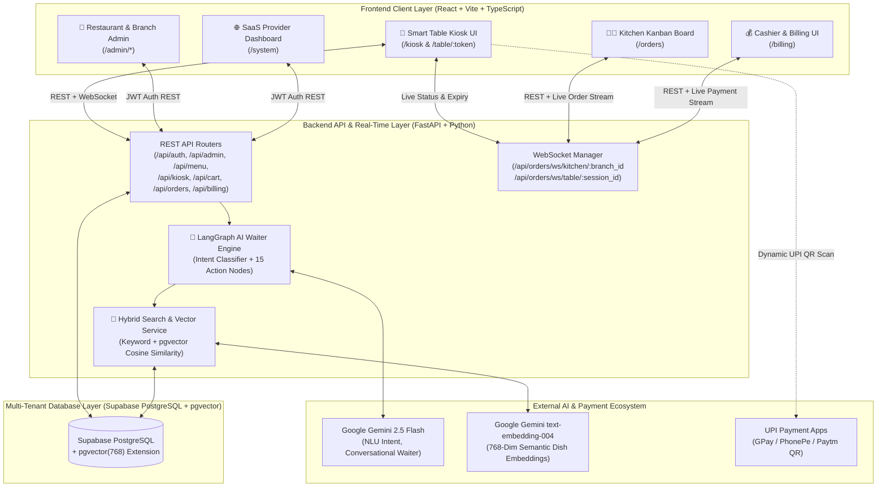
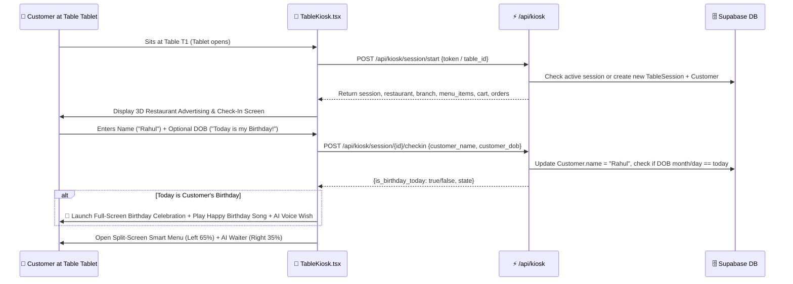
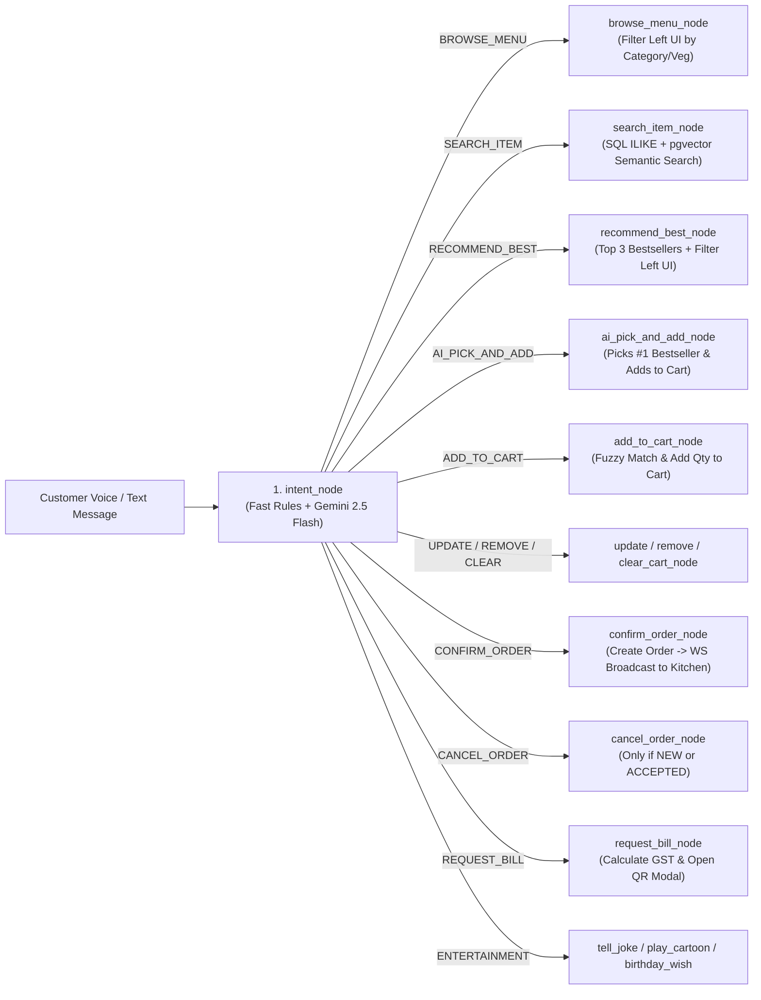
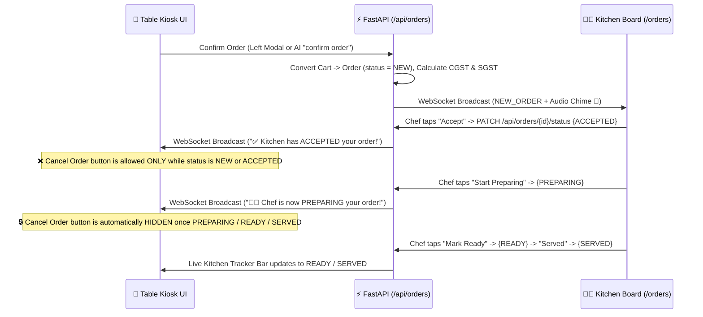
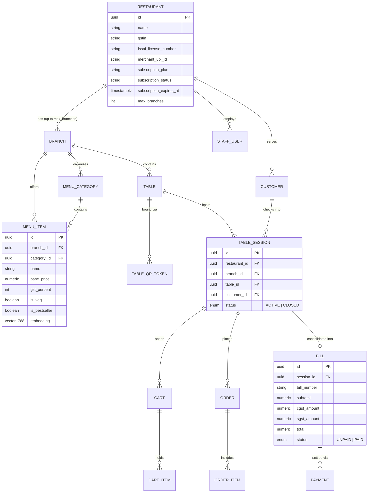

# HelloDine — System Architecture, Design & End-to-End Flow Guide

**HelloDine** is a Multi-Tenant SaaS Restaurant Smart Table Kiosk Ordering, AI Voice & Chat Waiter, Live Kitchen Kanban Board, and GST Table QR Billing platform designed for modern Indian restaurants.

---

## 1. High-Level System Architecture



---

## 2. User Roles, Permissions & Responsibilities (RBAC)

HelloDine enforces strict Role-Based Access Control (RBAC) on both the **React Frontend** (`RequireRole` route guards in `frontend/src/App.tsx`) and the **FastAPI Backend** (`get_current_staff` JWT dependency in `backend/app/services/auth_service.py`).

| Role | Who They Are | Default Login (Demo) | Allowed Routes | Core Responsibilities |
| :--- | :--- | :--- | :--- | :--- |
| **`SYSTEM_ADMIN`** | **SaaS Platform Owner (You)** | `+91 9000000000` / `sysadmin123` | `/system` | • Onboard new restaurants & create their initial `SUPER_ADMIN` owner account.<br>• Set maximum branch limits (`max_branches`) & SaaS subscription plans (`STARTER`, `PRO_AI`, `ANNUAL_PRO`).<br>• Verify UPI UTR payments from restaurants and click **Approve & Extend (+30d / +365d)**.<br>• Reset forgotten passwords for restaurant owners. |
| **`SUPER_ADMIN`** | **Restaurant Owner** | `+91 9000000001` / `admin123` | `/orders`, `/billing`, `/admin/menu`, `/admin/tables`, `/admin/staff`, `/admin/report`, `/admin/branches` | • Manage multiple branches (`BranchAdmin.tsx`) up to their `max_branches` limit.<br>• Configure the restaurant's **Merchant UPI ID** for table QR payments.<br>• Pay SaaS subscription renewals via QR & submit UTR.<br>• Full access to Menu, Tables, Staff, Daily/Corporate Reports, Billing, and Orders across all branches. |
| **`BRANCH_ADMIN`** | **Branch Manager** | Created by Owner | `/orders`, `/billing`, `/admin/menu`, `/admin/tables`, `/admin/staff`, `/admin/report` | • Manage a **single assigned branch**.<br>• Add/edit menu categories, items, prices, GST %, and ⭐ Bestseller badges.<br>• Create tables & generate permanent Table Kiosk QR links.<br>• Create Kitchen & Cashier staff for their branch and view branch sales reports. |
| **`CASHIER`** | **Billing Counter Staff** | `+91 9000000003` / `cashier123` | `/billing`, `/orders` | • Receive real-time WebSocket audio/visual alerts when a customer pays via Table UPI QR.<br>• View all open/unpaid table bills and mark Cash/Card/UPI payments as paid.<br>• Audit daily transaction logs with customer names and table numbers. |
| **`KITCHEN`** | **Chef / Kitchen Staff** | `+91 9000000002` / `kitchen123` | `/orders` | • Monitor the real-time **Kitchen Kanban Board** (`NEW` -> `ACCEPTED` -> `PREPARING` -> `READY` -> `SERVED`).<br>• Hear an instant audio chime when a table confirms an order.<br>• Update order status with one tap, which immediately notifies the customer's table tablet via WebSocket. |
| **Customer (Guest)** | **Dine-In Customer at Table** | No login needed (Bound via `/table/:token`) | `/kiosk`, `/table/:token` | • Check in with Name & optional Date of Birth on the 3D Welcome Screen.<br>• Browse visual menu or talk to the AI Voice/Chat Waiter.<br>• Place orders, track live kitchen status, enjoy kids cartoons/birthday songs, and pay the GST bill via Table UPI QR. |

---

## 3. Backend Directory & Module Structure (`d:\Hello-Dine\backend`)

```text
backend/
├── app/
│   ├── main.py                  # FastAPI entrypoint, CORS, Lifespan DB schema + pgvector + SYSTEM_ADMIN auto-seed
│   ├── config.py                # Pydantic settings (.env loader: DATABASE_URL, GEMINI_API_KEY, UPI IDs, JWT)
│   ├── database.py              # Async SQLAlchemy engine & session factory (Supabase PostgreSQL + asyncpg)
│   ├── models/                  # SQLAlchemy ORM Database Models
│   │   ├── tenancy.py           # Restaurant (SaaS plan, merchant_upi_id), Branch, Table, TableQRToken
│   │   ├── auth.py              # StaffUser & StaffRole enum (SYSTEM_ADMIN, SUPER_ADMIN, BRANCH_ADMIN, CASHIER, KITCHEN)
│   │   ├── menu.py              # MenuCategory, MenuItem (with is_bestseller & pgvector embedding(768)), ItemModifier
│   │   ├── customers.py         # Customer (name, wa_user_id), TableSession (ACTIVE / CLOSED)
│   │   ├── cart.py              # Cart (OPEN / CHECKED_OUT), CartItem, CartItemModifier
│   │   ├── orders.py            # Order (NEW, ACCEPTED, PREPARING, READY, SERVED, CANCELLED), OrderItem
│   │   └── billing.py           # Bill (UNPAID / PAID, CGST, SGST, Total), Payment (CASH, UPI, CARD)
│   ├── routers/                 # FastAPI REST & WebSocket Endpoints
│   │   ├── auth.py              # POST /api/auth/login, POST /api/auth/change-password
│   │   ├── restaurant.py        # /api/admin/* (Restaurants, SaaS Plans, Renewals, Branches, Tables, QR, Staff)
│   │   ├── menu.py              # /api/menu/* (Categories, Items, Modifiers, Auto Vector Embedding Sync)
│   │   ├── kiosk.py             # /api/kiosk/* (Start Session, 3D Check-in, AI Chat/Voice, Table QR Payment)
│   │   ├── cart.py              # /api/cart/* (Direct Kiosk UI Add, Update Quantity, Remove, Clear Cart)
│   │   ├── orders.py            # /api/orders/* (Confirm Order, Update Status, WebSocket Kitchen & Table Streams)
│   │   └── billing.py           # /api/billing/* (Generate Bill, Counter Pay, Daily & Corporate Analytics, Transactions)
│   ├── services/                # Core Business Logic Services
│   │   ├── auth_service.py      # Bcrypt password hashing, JWT token creation & verification
│   │   ├── vector_service.py    # Gemini text-embedding-004 generator & Supabase pgvector <=> cosine similarity search
│   │   └── ws_manager.py        # Real-time WebSocket connection manager (Branch broadcast & Table session broadcast)
│   └── bot/                     # LangGraph Conversational AI Waiter Engine
│       ├── state.py             # BotState TypedDict (session context, intent, entities, ui_action, final_response)
│       ├── graph.py             # LangGraph StateGraph wiring intent_node to 15 specialized action nodes
│       └── nodes/
│           ├── intent.py        # Fast deterministic rules + Gemini 2.5 Flash JSON Intent & Entity Classifier
│           ├── menu_and_format.py # BROWSE_MENU, SEARCH_ITEM (Hybrid Keyword + pgvector), RECOMMEND_BEST, ASK_ITEM_INFO
│           ├── cart_and_order.py  # ADD_TO_CART, AI_PICK_AND_ADD, UPDATE_QUANTITY, REMOVE, CONFIRM, CANCEL, STATUS, BILL
│           └── entertainment.py   # TELL_JOKE, PLAY_CARTOON, BIRTHDAY_WISH, GENERAL_CHAT
└── seed.py                      # Initial demo seed script (Spice Garden restaurant, KIIT Branch, tables, menu, staff)
```

---

## 4. Complete Start-to-End Application Flow

### Phase 1: SaaS Onboarding & Subscription Flow (`SYSTEM_ADMIN` -> `SUPER_ADMIN`)
1. **SaaS Owner Login**: You log in at `/login` with `+91 9000000000` / `sysadmin123` and land on `/system` (`SystemAdmin.tsx`).
2. **Onboard Restaurant**: You click **+ Onboard Restaurant** and enter:
   - Restaurant Name, Contact Phone, optional GSTIN/FSSAI
   - Restaurant's Merchant UPI ID (e.g., `spicegarden@okaxis`)
   - SaaS Plan (`STARTER` ₹1,999/mo, `PRO_AI` ₹3,499/mo, or `ANNUAL_PRO` ₹19,990/yr) and Max Allowed Branches
   - Initial Owner Phone & Password
3. **Backend Creation**:
   - `POST /api/admin/restaurants` creates the `Restaurant` tenant record.
   - `POST /api/admin/staff` creates the `SUPER_ADMIN` user linked to that `restaurant_id`.
4. **SaaS Renewal Flow**:
   - In `BranchAdmin.tsx`, the Restaurant Owner views their active subscription expiry date and scans your **HelloDine SaaS Owner UPI QR Code** (`SAAS_OWNER_UPI_ID` from `.env`).
   - After paying, the owner enters their 12-digit UPI UTR reference (`POST /api/admin/restaurants/{id}/request-renewal`).
   - You see an orange **🔔 Paid ₹1999 (UTR: ...)** badge on `/system` and click **✅ Approve & Extend**, which calls `POST /api/admin/restaurants/{id}/approve-renewal` and extends `subscription_expires_at` by 30 or 365 days.

---

### Phase 2: Restaurant Setup & Menu Vectorization (`SUPER_ADMIN` / `BRANCH_ADMIN`)
1. **Branch & Staff Setup**: The Restaurant Owner logs in, creates branches (`/admin/branches`), and creates Kitchen, Cashier, and Branch Admin accounts (`/admin/staff`).
2. **Menu Creation & Automatic `pgvector` Embedding**:
   - In `/admin/menu`, the admin creates Categories (`Veg Starters`, `Main Course`, `Beverages`, `Desserts`) and Menu Items (with `base_price`, `gst_percent`, `is_veg`, `spice_level`, and `is_bestseller`).
   - Whenever an item is created (`POST /api/menu/items`) or updated (`PATCH /api/menu/items/{id}`), `vector_service.py` automatically builds a rich semantic document (combining Dish Name, Category, Veg/Non-Veg, Bestseller status, Spice Level, Price, and Description) and calls Google Gemini `text-embedding-004` to store a **768-dimension vector** in `menu_items.embedding` (`vector(768)` in Supabase).
3. **One-Time Table Tablet Setup**:
   - In `/admin/tables`, the admin creates tables (`T1`, `T2`, etc.) and clicks **Generate QR**.
   - This creates an unrevoked token in `table_qr_tokens` and returns a permanent link `/table/<token>`.
   - On each table's tablet, the manager opens `/table/<token>` (or selects the table once on `/kiosk`) and adds it to the tablet's Home Screen. Both the URL token and `localStorage` (`hd_kiosk_token`, `hd_kiosk_table_id`) permanently bind that tablet to that specific table.

---

### Phase 3: New Customer Session & 3D Welcome Screen (`TableKiosk.tsx`)


1. **Session Initialization (`POST /api/kiosk/session/start`)**:
   - When a tablet loads, if the previous session was paid, closed, idle for >2 hours, or had no placed orders, the backend closes the old session and starts a fresh `TableSession` with default guest name `Table X Guest`.
2. **3D Welcome & Advertising Screen**:
   - Because the new session has not been checked into yet, `TableKiosk.tsx` renders a **3D-perspective Welcome Page** showcasing the Restaurant's name, branch address, table badge, and 4 Chef Bestseller dishes with food photos.
   - The customer enters their **Name** (required) and **Date of Birth** (optional).
3. **Customer Check-In (`POST /api/kiosk/session/{session_id}/checkin`)**:
   - Updates `Customer.name` in PostgreSQL so the Kiosk header, Kiosk GST Invoice (`Billed To: <Name>`), and Cashier Billing Dashboard all carry the customer's name.
   - If the customer's DOB month & day match today's date (or they ticked *"🎉 Today is my Birthday!"*), the Kiosk immediately plays the synthesized **Happy Birthday melody** and speaks a personalized birthday greeting before revealing the main ordering interface.

---

### Phase 4: Dual-Mode Ordering — Visual Touch Menu vs. AI Voice/Chat Waiter

Once inside the main Kiosk interface, the screen is split into two synchronized panels:

#### A. Left Panel (65%): Direct Visual Touch Ordering (Silent & Instant)
- Customers filter by Category pills, `Veg` / `Non-Veg`, or instant keyword search.
- Tapping **+ Add** or `+ / -` calls `POST /api/cart/add` or `POST /api/cart/update` directly.
- **No AI tokens are spent** and **no voice is spoken** for normal left-side taps, keeping browsing fast and distraction-free.

#### B. Right Panel (35%): AI Voice & Chat Waiter (`POST /api/kiosk/chat`)
- **3-Second Voice Pause Detection**: When the customer taps **🎤**, Web Speech API (`en-IN`) listens continuously and resets a 3-second timer (`voiceWaitTimerRef`) after each spoken phrase so customers can pause naturally while thinking before the message is sent.
- **LangGraph Bot Pipeline (`backend/app/bot/graph.py`)**:
  Every message enters `intent_node` (`intent.py`) and routes to one of **15 specialized nodes**:



- **How Hybrid Search & Recommendations Work**:
  1. **General Item Search (`SEARCH_ITEM`)**: First runs fast SQL keyword matching (`ILIKE`). If the customer asks a conceptual question (*"something light and creamy for kids"*, *"spicy starter under 250"*), it falls back to `semantic_search_menu_items()` in `vector_service.py` using Supabase `pgvector` cosine distance (`MenuItem.embedding.cosine_distance(query_vec)`).
  2. **Top-3 Bestseller Recommender (`RECOMMEND_BEST`)**: When a confused customer asks *"What is your best dish?"* or *"Best in main course?"*, `recommend_best_node` selects the **Top 3 items** (prioritizing `is_bestseller == True` first) per category or for the requested category, syncs the left-side menu grid to display those exact cards (`ui_action: FILTER_MENU`), and replies like a warm human waiter.
  3. **AI Auto-Pick & Add (`AI_PICK_AND_ADD`)**: When a customer says *"I am confused, choose the best starter and add 1 for me"*, `ai_pick_and_add_node` automatically picks the #1 bestseller in that category, adds it to the open `Cart` in PostgreSQL, and asks if they'd like to confirm the order.

---

### Phase 5: Order Confirmation, Live Kitchen Kanban & Cancellation Rules



1. **Order Placement**:
   - Whether confirmed via the Left UI Modal (`POST /api/orders/confirm`) or via AI voice/chat (`confirm_order_node`), the backend converts all `CartItem` rows into an `Order` (`status = NEW`), calculates item-level CGST (`gst_percent / 2`) and SGST (`gst_percent / 2`), marks the `Cart` as `CHECKED_OUT`, and broadcasts `NEW_ORDER` to `/api/orders/ws/kitchen/{branch_id}`.
2. **Strict Cancellation Guard**:
   - Customers can cancel an order (`CANCEL_ORDER`) **only** when the order status is `NEW` or `ACCEPTED`.
   - Once the chef clicks **Start Preparing** (`PREPARING`), **Ready** (`READY`), or **Served** (`SERVED`), both the frontend (`hasCancellableOrder` in `TableKiosk.tsx`) and backend (`cancel_order_node` in `cart_and_order.py`) block cancellation so kitchen food is never wasted.

---

### Phase 6: Consolidated GST Billing, Table UPI QR Payment & Session Reset

1. **Opening the GST Bill (`SHOW_BILL`)**:
   - Tapping **🧾 GST Bill & QR Pay** (or asking the AI *"how much is my bill?"*) opens the Consolidated GST Tax Invoice Modal.
   - Displays **Restaurant Name**, **Branch**, **GSTIN**, **Table Number**, **`Billed To: <Customer Name>`**, itemized quantities, **Taxable Subtotal**, **CGST**, **SGST**, and **Grand Total**.
   - Generates a live scannable **UPI QR Code** (`upi://pay?pa=<restaurant.merchant_upi_id>&pn=<Restaurant>&am=<GrandTotal>&cu=INR`) locked to that restaurant's configured `merchant_upi_id`.
   - The AI voice assistant speaks a brief prompt (*"Please review your invoice details on the screen and scan the QR code for payment"*) without reading every line item aloud.
2. **Payment Completion & Live Cashier Notification (`POST /api/kiosk/session/{session_id}/pay-qr`)**:
   - When the customer completes the UPI QR payment (or when the Cashier marks a bill paid at the counter via `POST /api/billing/{bill_id}/pay`):
     1. All active orders for the session are aggregated into a `Bill` (`status = PAID`) and a `Payment` record is saved.
     2. The `TableSession` is marked `CLOSED`.
     3. **Cashier WebSocket Broadcast**: Sends `TABLE_QR_BILL_PAID` to `/api/orders/ws/kitchen/{branch_id}`, displaying a green live banner on `Billing.tsx` (`🔔 Payment Received — Table T1 Paid ₹...`) and updating the Daily Revenue counter.
     4. **Table Goodbye & Auto-Reset**: The tablet displays a **10-second Goodbye & Payment Receipt Screen** and then automatically starts a fresh session and returns to the **3D Restaurant Welcome Screen** for the next guest!

---

## 5. Database Entity-Relationship Diagram (ERD)



